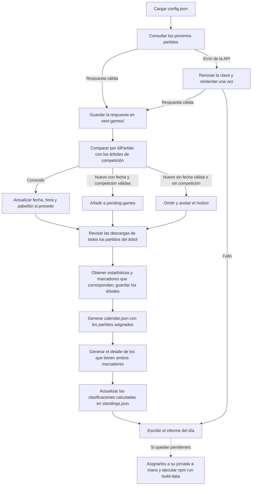

# Flujo de sincronización

`npm run sync` ejecuta [src/sync.js](../src/sync.js). La descarga incluye tanto
partidos asignados a una jornada como pendientes; solo los asignados aparecen en la web.

**Partidos nuevos.** Se busca una competición de la temporada actual comparando
la categoría recibida con la del catálogo, sin los sufijos ` - ORO` y
` - PLATA/BRONCE`. No se modifica la categoría del catálogo.

**Descargas.** Se omiten los partidos marcados como descargados y se espera a que
pasen más de tres horas desde el inicio previsto. Si ya existen estadísticas y
marcador, se reutilizan; si solo existe uno, la ejecución se detiene. Si la API
responde «sin datos», se continúa con el siguiente partido.

**Clasificaciones.** Tanto `npm run sync` como `npm run build-data` calculan las
fases con `standings.type: "computed"` en `src/data/competitions.json`. Usan los
marcadores guardados en las jornadas de `src/data/<competitionId>.json` y
actualizan `src/data/standings.json` sin reemplazar las clasificaciones manuales.

**Informe.** Si falla la configuración, el proceso termina sin informe. Ante un
fallo posterior que interrumpa la ejecución, se intenta guardar el progreso y el
error en `<outputDir>/sync-reports/<YYYY-MM-DD>.md`. Cada ejecución reemplaza el
informe anterior del mismo día.
